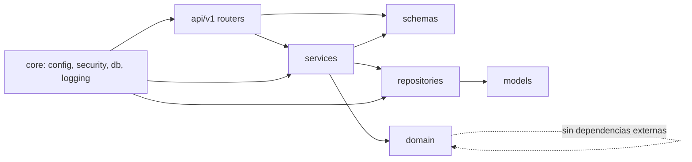
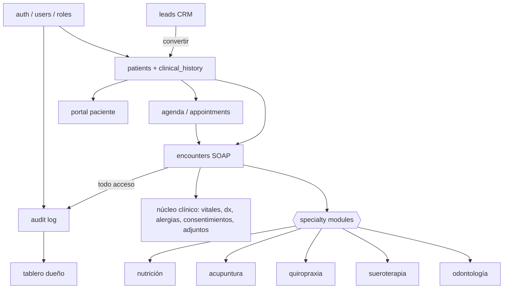
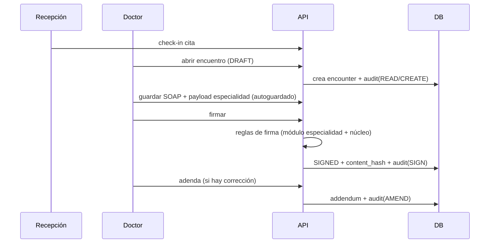

# GRAPH.md — Estructura viva del proyecto

> Actualizar cuando cambie la estructura. Leyenda: ✅ existe · ⬜ planificado.

## 1. Árbol de carpetas (objetivo)
```
crmFichaClinica/
├─ CLAUDE.md ✅  LOGS.md ✅  AGENTS.md ✅  GRAPH.md ✅  README.md ✅
├─ docs/ ✅  (00 plan · 01 investigación · 02 arquitectura · 03 datos · 04 roles · 05 fichas · 06 seguridad · 07 crm/agenda)
├─ .claude/skills/ ✅  (backend-layer-feature · frontend-feature · clinical-specialty-module)
├─ docker-compose.yml ⬜  .env.example ⬜  .gitignore ⬜  .pre-commit-config.yaml ⬜
├─ .github/workflows/ci.yml ⬜
├─ backend/ ⬜
│  ├─ app/{main.py, core/, domain/{policies/, specialties/}, models/, repositories/, services/, schemas/, api/{deps.py, v1/}}
│  ├─ alembic/  tests/{unit,integration,architecture}  scripts/{seed.py, verify_audit_chain.py}
│  └─ pyproject.toml  Dockerfile
└─ frontend/ ⬜
   ├─ src/{app/, shared/, entities/, features/{auth,patients,leads,agenda,dashboard,clinical-record/{core,specialties/*}}, pages/}
   └─ package.json  vite.config.ts  tsconfig.json  Dockerfile
```

## 2. Dependencias entre capas (backend)

Prohibido: `api → models`, `domain → fastapi|sqlalchemy`, `repositories → services`.

## 3. Módulos funcionales y dependencias


## 4. Flujo de datos de una atención


## 5. Estado
Ver `LOGS.md`. Hoy: solo documentación y skills (planificación).
