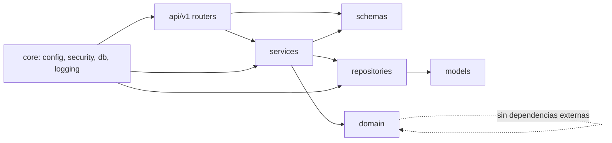
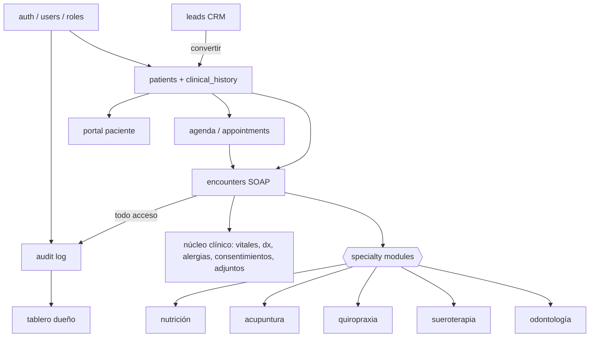
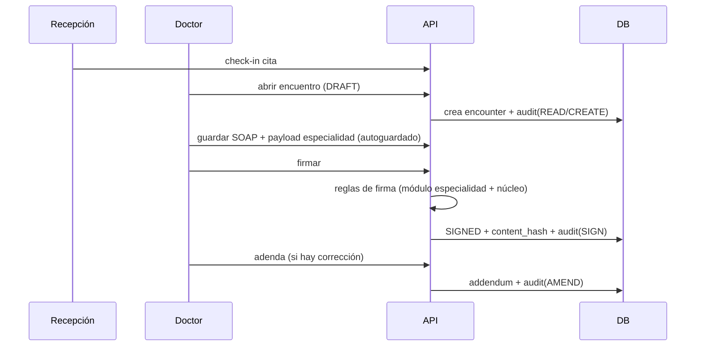

# GRAPH.md — Estructura viva del proyecto

> Actualizar cuando cambie la estructura. Leyenda: ✅ existe · ⬜ planificado.

## 1. Árbol de carpetas (objetivo)
```
crmFichaClinica/
├─ CLAUDE.md ✅  LOGS.md ✅  AGENTS.md ✅  GRAPH.md ✅  README.md ✅
├─ docs/ ✅  (00 plan · 01 investigación · 02 arquitectura · 03 datos · 04 roles · 05 fichas · 06 seguridad · 07 crm/agenda)
├─ .claude/skills/ ✅  (backend-layer-feature · frontend-feature · clinical-specialty-module)
├─ docker-compose.yml ✅  docker-compose.prod.yml ✅  .env.example ✅  .gitignore ✅  .pre-commit-config.yaml ✅
├─ .github/workflows/ci.yml ✅  scripts/dev/{start-api.sh, stop-api.py} ✅
├─ backend/ ✅ (Fase 0: core, health, tests de arquitectura; resto ⬜)
│  ├─ app/{main.py, core/, domain/{policies/, specialties/}, models/, repositories/, services/, schemas/, api/{deps.py, v1/}}
│  ├─ alembic/  tests/{unit,integration,architecture}  scripts/{seed.py, verify_audit_chain.py}
│  └─ pyproject.toml ✅  Dockerfile ✅  alembic/versions/{0001 extensiones, 0002 identidad+auditoría, 0003 pacientes+CRM, 0004 agenda} ✅
└─ frontend/ ✅ (Fases 0-3: shell, auth, users, audit, patients, leads, agenda; resto ⬜)
   ├─ src/{app/, shared/, entities/, features/{auth,patients,leads,agenda,dashboard,clinical-record/{core,specialties/*}}, pages/}
   └─ package.json  vite.config.ts  tsconfig.json  Dockerfile
```

## 2. Dependencias entre capas (backend)

Prohibido: `api → models`, `domain → fastapi|sqlalchemy`, `repositories → services`.

## 3. Módulos funcionales y dependencias


## 4. Flujo de datos de una atención


## 5. Fase 1 — componentes implementados (backend)
| Capa | Módulos |
|---|---|
| `domain` | `enums`, `password_policy`, `audit_chain`, `policies/permissions` (RBAC) |
| `models` | `user` (User, UserRole, DoctorProfile, DoctorSpecialty, RefreshToken), `audit_log` |
| `repositories` | `users`, `refresh_tokens`, `audit`, `unit_of_work` |
| `services` | `auth`, `users`, `audit` |
| `schemas` | `auth`, `users`, `audit` |
| `api/v1` | `auth` (login/refresh/logout/me), `users` (CRUD), `audit` (listar/verificar) |
| `core` | `security` (Argon2id, JWT, refresh), `clock`, `config` (cookies, bloqueo) |
| `scripts` | `seed.py` (8 usuarios demo), `export_openapi.py` |

## 6. Fase 1 — componentes implementados (frontend)
| Zona | Contenido |
|---|---|
| `app/` | `AppLayout`, `navigation`, `guards/{RequireAuth,RoleGuard}`, `router`, `providers` |
| `shared/lib` | `http` (refresh único + reintento), `accessToken` (solo memoria), `apiError`, `labels`, `dates` (Lima), `passwordPolicy` |
| `shared/ui` | Alert, Badge, Button, CheckboxGroup, Field, Input/Select, Pagination, Spinner, Table |
| `entities/user` | `permissions` (`can`, `canAssignRole`, `canManageUser`) |
| `features/auth` | `AuthProvider`, `useAuth`, `LoginForm`, `useIdleLogout` |
| `features/users` | `UsersManager`, `UsersTable`, `UserCreateForm`, `UserEditForm`, `RoleCheckboxes` |
| `features/audit` | `AuditPanel`, `AuditTable`, `IntegrityCheck` |
| `pages/` | Home, Login, Users, Audit, Forbidden, NotFound |
Rutas: `/login` (pública) · `/` · `/usuarios` y `/auditoria` (OWNER/SUPERUSER).

## 7. Fase 2 — componentes implementados
| Zona | Contenido |
|---|---|
| `backend/domain` | `patient_rules` (documento, edad, teléfono, HC, apoderado), `lead_funnel` (transiciones), permisos de pacientes/leads |
| `backend/models` | `patient` (Patient, ClinicalHistory, CareTeamMember), `lead` (Lead, LeadActivity) |
| `backend/repositories` | `patients` (búsqueda trigram+unaccent, duplicados), `care_team`, `leads` (filtros, seguimientos, estadísticas), `errors` |
| `backend/services` | `patients` (alta+HC, acceso por relación terapéutica, edición, equipo), `leads` (embudo, actividades, conversión atómica, estadísticas) |
| `backend/api/v1` | `patients`, `leads`, `doctors` |
| `frontend/entities` | `patient` (formulario compartido, edad, duplicados), `doctor`, `user/permissions` |
| `frontend/features` | `patients` (lista, alta, ficha, equipo tratante), `leads` (Kanban, detalle, actividades, conversión, seguimientos, estadísticas) |
| `frontend/shared/ui` | + Dialog, Tabs, Textarea, CheckboxField |
Rutas nuevas: `/pacientes` · `/pacientes/nuevo` · `/pacientes/:id` · `/leads` · `/leads/:id` · `/leads/:id/convertir`.

## 8. Fase 3 — componentes implementados
| Zona | Contenido |
|---|---|
| `backend/domain` | `agenda_rules` (estados, horario laboral, huecos, solapamiento, hora de Lima), `clinic` (zona horaria), permisos `agenda:*` y `schedule:manage` |
| `backend/models` | `agenda` (DoctorSchedule, ScheduleException, Room, AppointmentType, Appointment + 3 restricciones de exclusión) |
| `backend/repositories` | `appointments` (calendario, solapamientos, disponibilidad), `schedules`, `agenda_catalog` (salas y tipos) |
| `backend/services` | `appointments` (agendar, series, reprogramar, estados, disponibilidad, relación terapéutica), `schedules` (configuración) |
| `backend/api/v1` | `appointments`, `agenda_config` |
| `backend/scripts` | `seed_agenda.py` |
| `frontend/features/agenda` | calendario semanal/diario + lista, detalle de cita, asistente de nueva cita, Hoy, Mi agenda, configuración (horarios, excepciones, salas, tipos) |
| `frontend/entities` | `appointment` (lista, estado, citas del paciente), `patient/usePatientLookup` |
| `frontend/shared` | `lib/dates` (utilidades de Lima), `ui/Dialog` mejorado |
Rutas nuevas: `/agenda` · `/agenda/hoy` · `/agenda/nueva` · `/agenda/configuracion` · `/mi-agenda`.

## 9. Estado
Ver `LOGS.md`. Hoy: Fases 0, 1, 2 y 3 completas (backend + frontend).
