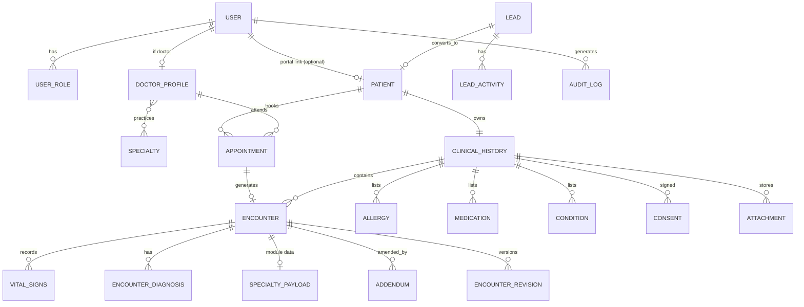

# 03 · Modelo de datos

Convenciones: PK `UUID` (v7 cuando esté disponible), `created_at/updated_at` UTC, `created_by`, borrado **lógico** (`deleted_at`) y nunca físico en datos clínicos. Nombres en inglés en código; etiquetas en español en UI.

## 1. Diagrama (alto nivel)



## 2. Tablas principales

### Identidad y acceso
| Tabla | Campos clave |
|---|---|
| `users` | id, email (único), password_hash (Argon2id), full_name, phone, is_active, totp_secret (cifrado), last_login_at |
| `user_roles` | user_id, role ∈ {SUPERUSER, OWNER, DOCTOR, RECEPTION, PATIENT} |
| `doctor_profiles` | user_id, license_number (nº colegiatura), professional_body (CMP/COP/CNP/otro), rne (opcional), signature_image, is_owner_practitioner |
| `doctor_specialties` | doctor_id, specialty ∈ {ACUPUNCTURE, NUTRITION, CHIROPRACTIC, IV_THERAPY, DENTISTRY} |
| `care_team` | patient_id, doctor_id, since, until — **relación terapéutica** que habilita acceso a la ficha |
| `refresh_tokens` | user_id, token_hash, expires_at, revoked_at, user_agent, ip |

### CRM
| Tabla | Campos clave |
|---|---|
| `leads` | full_name, phone, email, interest_specialty[], source ∈ {WEB, REFERRAL, INSTAGRAM, FACEBOOK, WALK_IN, OTHER}, status ∈ {NEW, CONTACTED, QUALIFIED, APPOINTMENT_SET, CONVERTED, LOST}, lost_reason, assigned_to, consent_marketing, converted_patient_id |
| `lead_activities` | lead_id, type ∈ {CALL, WHATSAPP, EMAIL, NOTE, STATUS_CHANGE}, notes, next_action_at, created_by |

### Pacientes y agenda
| Tabla | Campos clave |
|---|---|
| `patients` | document_type ∈ {DNI, CE, PASSPORT, OTHER}, document_number (único con tipo), first_name, last_name, birth_date, sex, marital_status, occupation, address, district, phone, email, emergency_contact{name, phone, relation}, guardian{…} (obligatorio < 18), insurance, referral_source, data_processing_consent_at |
| `clinical_histories` | patient_id (1:1), hc_number (único, secuencial), opened_at, retention_until |
| `rooms` | name, specialty_ids[] |
| `doctor_schedules` | doctor_id, weekday, start, end, slot_minutes, valid_from/to |
| `schedule_exceptions` | doctor_id, date, reason (vacaciones, feriado) |
| `appointments` | patient_id, doctor_id, specialty, room_id, starts_at, ends_at, status ∈ {SCHEDULED, CONFIRMED, CHECKED_IN, IN_PROGRESS, COMPLETED, NO_SHOW, CANCELLED}, reason, notes_admin (sin datos clínicos), series_id (sesiones) |

### Núcleo clínico
| Tabla | Campos clave |
|---|---|
| `encounters` | history_id, appointment_id?, doctor_id, specialty, status ∈ {DRAFT, SIGNED, AMENDED}, occurred_at, subjective, objective_notes, assessment_notes, plan, followup_at, signed_at, signed_by, content_hash |
| `vital_signs` | encounter_id, measured_at, systolic, diastolic, heart_rate, resp_rate, temperature_c, spo2, weight_kg, height_cm, bmi (calc.), pain_vas (0-10), context (pre/durante/post para sueroterapia) |
| `encounter_diagnoses` | encounter_id, icd10_code, description, type ∈ {PRESUMPTIVE, DEFINITIVE}, is_primary |
| `specialty_payloads` | encounter_id (1:1), specialty, schema_version, data JSONB |
| `allergies` | history_id, substance, reaction, severity ∈ {MILD, MODERATE, SEVERE}, status, verified_at, verified_by |
| `medications` | history_id, name, dose, route, frequency, since, until, prescriber |
| `conditions` | history_id, icd10_code?, description, kind ∈ {PERSONAL, FAMILY, SURGICAL, HABIT}, active |
| `consents` | history_id, type ∈ {DATA_PROCESSING, GENERAL_CARE, ACUPUNCTURE_INVASIVE, CHIROPRACTIC_MANIPULATION, IV_THERAPY, DENTAL_PROCEDURE, PHOTO_USE}, text_version, signed_at, signed_method, signature_image, witness, revoked_at |
| `attachments` | history_id, encounter_id?, kind ∈ {LAB, IMAGING, PHOTO, REPORT, OTHER}, storage_key, sha256, mime, size, has_patient_consent |
| `addenda` | encounter_id, reason, text, created_by, created_at |
| `encounter_revisions` | encounter_id, version, snapshot JSONB, changed_by, changed_at (solo mientras es DRAFT o por adenda) |
| `referrals` | encounter_id, to_specialty/external, reason, status, response |

### Catálogos
`icd10_codes` (código, descripción, búsqueda trigram), `acupuncture_points` (código OMS tipo `LI4`, nombre pinyin/es, meridiano, coordenadas SVG), `iv_protocols` (componentes por defecto), `dental_symbols` (simbología oficial), `consent_templates` (texto versionado).

### Seguridad y cumplimiento
| Tabla | Campos clave |
|---|---|
| `audit_logs` | id, ts, actor_user_id, actor_role, action ∈ {READ, CREATE, UPDATE, SIGN, AMEND, EXPORT, PRINT, LOGIN, LOGIN_FAILED, BREAK_GLASS, …}, resource_type, resource_id, patient_id, ip, user_agent, outcome, reason, prev_hash, row_hash — **append-only** (revocar UPDATE/DELETE en BD) |
| `access_requests` | patient_id, type ∈ {ACCESS, RECTIFICATION, CANCELLATION, OPPOSITION, PORTABILITY}, status, due_at, resolved_at |
| `break_glass_grants` | user_id, patient_id, reason, expires_at, reviewed_by |

## 3. Payload por especialidad (JSONB, `schema_version = 1`)

```jsonc
// ACUPUNCTURE
{ "tcm": {"tongue": {"body_color":"", "coating":"", "shape":""}, "pulse": {"left":[], "right":[]},
          "pattern":"", "principle":""},
  "style": "TCM",
  "points": [{"code":"LI4","side":"L|R|B","technique":"NEEDLE|MOXA|CUPPING|ELECTRO|LASER",
              "needle_gauge":null,"depth_mm":null,"retention_min":null}],
  "needle_count": 0, "adverse_events": [], "adjuncts": ["MOXA","CUPPING","GUA_SHA"] }

// NUTRITION
{ "anthropometry": {"waist_cm":0,"hip_cm":0,"body_fat_pct":0,"lean_mass_kg":0,"skinfolds":{}},
  "diet_history": {"recall_24h":[],"frequency":{}, "water_l":0, "supplements":[]},
  "labs": [{"name":"","value":0,"unit":"","date":""}],
  "pes": {"problem":"","etiology":"","signs":""},
  "requirements": {"formula":"MIFFLIN","kcal":0,"protein_g":0,"carbs_pct":0,"fat_pct":0},
  "meal_plan": {}, "goals": [{"text":"","due":""}] }

// CHIROPRACTIC
{ "red_flags_screened": {"cauda_equina":false,"vascular_cervical":false,"recent_trauma":false,
                         "osteoporosis":false,"cancer_history":false,"anticoagulants":false,
                         "progressive_neuro_deficit":false,"override_reason":null},
  "rom": [{"region":"CERVICAL","motion":"FLEXION","degrees":0,"pain":false}],
  "ortho_tests": [{"name":"SLR","side":"L","result":"POSITIVE|NEGATIVE|EQUIVOCAL"}],
  "neuro": {"reflexes":{}, "dermatomes":{}, "myotomes":{}},
  "posture": {"notes":"","photos":[]},
  "part": {"pain":"", "asymmetry":"", "rom":"", "tone":""},
  "adjustments": [{"segment":"L4","technique":"DIVERSIFIED","direction":""}],
  "outcome_scores": [{"scale":"ODI|NDI|VAS","score":0}] }

// IV_THERAPY
{ "screening": {"g6pd":null,"renal_failure":false,"heart_failure":false,"pregnancy":false,"allergies_checked":true},
  "prescription": {"protocol":"","prescribed_by_doctor_id":""},
  "access": {"site":"","catheter_gauge":""},
  "components": [{"name":"","dose":"","unit":"","lot":"","expiry":""}],
  "volume_ml": 0, "rate_ml_h": 0, "started_at":"", "ended_at":"",
  "vitals_series_ref": true, "adverse_reactions": [{"type":"","action":"","at":""}],
  "administered_by":"" }

// DENTISTRY
{ "dentition": "PERMANENT|DECIDUOUS|MIXED",
  "odontogram": {"11":{"O":"CARIES","M":null,"D":null,"V":null,"L":null,"whole":null}},
  "odontogram_type": "INITIAL|EVOLUTIVE",
  "periodontal": {"11":{"probing_mm":[0,0,0,0,0,0],"bleeding":[false],"mobility":0}},
  "hygiene_index": {"type":"O'LEARY","value":0},
  "occlusion": {}, "treatment_plan": [{"tooth":"11","procedure":"","status":"PLANNED|DONE","cost":null}] }
```

## 4. Reglas de integridad (resumen)
- `Encounter` firmado ⇒ campos de solo lectura en BD vía servicio y `content_hash` recalculable.
- Paciente < 18 ⇒ `guardian` obligatorio.
- Única `(document_type, document_number)`.
- `appointments` sin solapamiento por doctor/sala (constraint de exclusión `tstzrange`).
- `audit_logs`: `REVOKE UPDATE, DELETE` al rol de la aplicación.


## 5. Implementado en Fase 2 (pacientes y CRM): desviaciones del diseño original
| Tema | Diseño original | Implementado | Motivo |
|---|---|---|---|
| Apoderado y contacto de emergencia | JSON anidado | **Columnas planas** `guardian_*` / `emergency_contact_*` | Se pueden consultar, indexar y validar en BD; la API sigue exponiéndolos como objetos anidados |
| Nº de historia clínica | "secuencial" | `hc_number` desde la **secuencia de BD** `hc_number_seq`; presentación `HC-000042` | Sin huecos ni duplicados bajo concurrencia (probado con 5 altas simultáneas) |
| Retención | `retention_until` | Se calcula al abrir: hoy + `RETENTION_YEARS` (20, **[VERIFICAR]**) | Se recalculará con la última atención en Fase 4 |
| Relación terapéutica (`care_team`) | Fase 3/4 | **Adelantada a Fase 2** (asignar/finalizar doctor) | Es la base de la autorización de doctores sobre pacientes; mejor probarla desde ya |
| Archivado de pacientes | — | `is_active` (nunca se borra) | Regla de datos clínicos: sin borrado físico |
| Próxima acción del lead | derivada | `leads.next_action_at` **denormalizada** + `status_changed_at` | "Seguimientos de hoy" con una consulta simple e indexada |
| Búsqueda de pacientes | `pg_trgm` | `pg_trgm` + **`f_unaccent()`** (envoltorio IMMUTABLE de `unaccent`) e índice GIN sobre `f_unaccent(lower(nombre completo))` | Recepción escribe sin tildes: "Maria Gomez" debe encontrar "María Gómez". Medido: 5–27 ms con 20.000 pacientes (índice usado) |
| Auditoría de pacientes | — | Se guarda `patient_id` y **solo nombres de campos** modificados, jamás valores | La auditoría la leen más roles que la ficha; test de regresión sin datos personales |

Tablas nuevas: `patients`, `clinical_histories`, `care_team` (índice único parcial: un doctor activo por paciente), `leads`, `lead_activities`.


## 6. Implementado en Fase 3 (agenda): desviaciones del diseño original
| Tema | Diseño original | Implementado | Motivo |
|---|---|---|---|
| No solapamiento | "constraint de exclusión" | **3 restricciones `EXCLUDE USING gist`** sobre `tstzrange(starts_at, ends_at, '[)')`: por doctor, por sala (si hay) y por paciente; solo para citas que ocupan el calendario (todas menos `CANCELLED`/`NO_SHOW`) | La garantía vive en PostgreSQL (`btree_gist`): aguanta carreras entre peticiones y escrituras fuera de la API. Rango semiabierto: citas consecutivas no chocan |
| Tipos de cita | por especialidad | `appointment_types` (especialidad, nombre, duración); único por (especialidad, nombre) | Duración por defecto configurable |
| Salas | por especialidad | `rooms.specialties[]`, vacío = cualquier especialidad | Una sala polivalente es común en clínicas pequeñas |
| Horarios | semanal + excepciones | `doctor_schedules` (varios bloques por día, vigencia desde/hasta, intervalo de huecos) y `schedule_exceptions` (doctor concreto **o toda la clínica** con `doctor_user_id NULL`) | Almuerzo = hueco entre dos bloques; feriados globales sin repetir por doctor |
| Series | `series_id` | `appointments.series_id` + endpoint de serie **todo-o-nada** que informa de TODAS las sesiones problemáticas | Evita paquetes a medias |
| Relación terapéutica | manual (Fase 2) | **Automática al agendar** (`care_team`, auditada con motivo "al agendar") | Habilita al doctor a ver a su paciente |
| Cancelación | estado | `cancel_reason` obligatorio (máx. 200) | Trazabilidad y métricas |

Todas las horas se guardan en UTC y se interpretan en `America/Lima`. Un bloque de trabajo es **hora local**; una cita debe caber **entera dentro de un único bloque** (no puede cruzar el almuerzo ni la medianoche).

## 7. Implementado en Fase 4 (núcleo clínico): desviaciones del diseño original
Migración `0005_clinical_core`. Tablas: `allergies`, `medications`, `conditions`, `icd10_codes`, `consent_templates`, `consents`, `encounters`, `vital_signs`, `encounter_diagnoses`, `addenda`, `specialty_payloads`, `attachments`.
- **Una sola fila de signos vitales por medición** (`context`: `SINGLE`, `PRE`, `DURING`, `POST`): sueroterapia registra la serie PRE/DURANTE/POST; el resto una medición. El **IMC lo calcula siempre el servidor** (el cliente no lo envía).
- **Diagnósticos**: CIE-10 normalizado (`M545` → `M54.5`), único por encuentro, exactamente un principal. El catálogo `icd10_codes` cargado es una **muestra de 112 códigos de ejemplo**; un código válido que no esté se acepta si el doctor escribe la descripción. Cargar el catálogo oficial completo queda pendiente **[VERIFICAR] fuente y licencia**.
- **Encuentro**: `DRAFT → SIGNED → AMENDED`. Al firmar se congela `content_hash` (SHA-256 del JSON canónico de SOAP + vitales + diagnósticos + payload), el nombre y colegiatura del firmante y `signed_at`. Un índice único parcial impide dos encuentros para la misma cita.
- **Adendas** (`addenda`): solo se añaden a encuentros firmados; no alteran el contenido firmado ni el hash.
- **Payload de especialidad** (`specialty_payloads`, JSONB + `schema_version`): la tabla y el contrato `SpecialtyModule` existen, pero el registro está **vacío hasta la Fase 5** (sin módulo, `PUT specialty-payload` devuelve 422).
- **Consentimientos**: texto versionado (`consent_templates`, 7 tipos, todos marcados "EJEMPLO — NO CONSTITUYE UN TEXTO LEGAL VALIDADO"). Cada `consents` guarda la versión exacta firmada; solo se pueden modificar las columnas de revocación.
- **Adjuntos**: metadatos en BD (sha256, tamaño, mime, nombre solo para mostrar) y bytes en `storage_dir` con nombre aleatorio. **Pendiente de producción**: almacenamiento cifrado/objeto (S3 compatible) y antivirus.
- **Triggers de BD** (defensa en profundidad, la API no es la única barrera): `encounters_guard`, `encounter_children_guard` (vitales, diagnósticos y payload solo con el padre en borrador), `addenda_guard` (solo insertar en firmados, append-only), `consents_guard`, `no_mutation_guard` en adjuntos y `no_delete_guard` en alergias, medicación y antecedentes.
